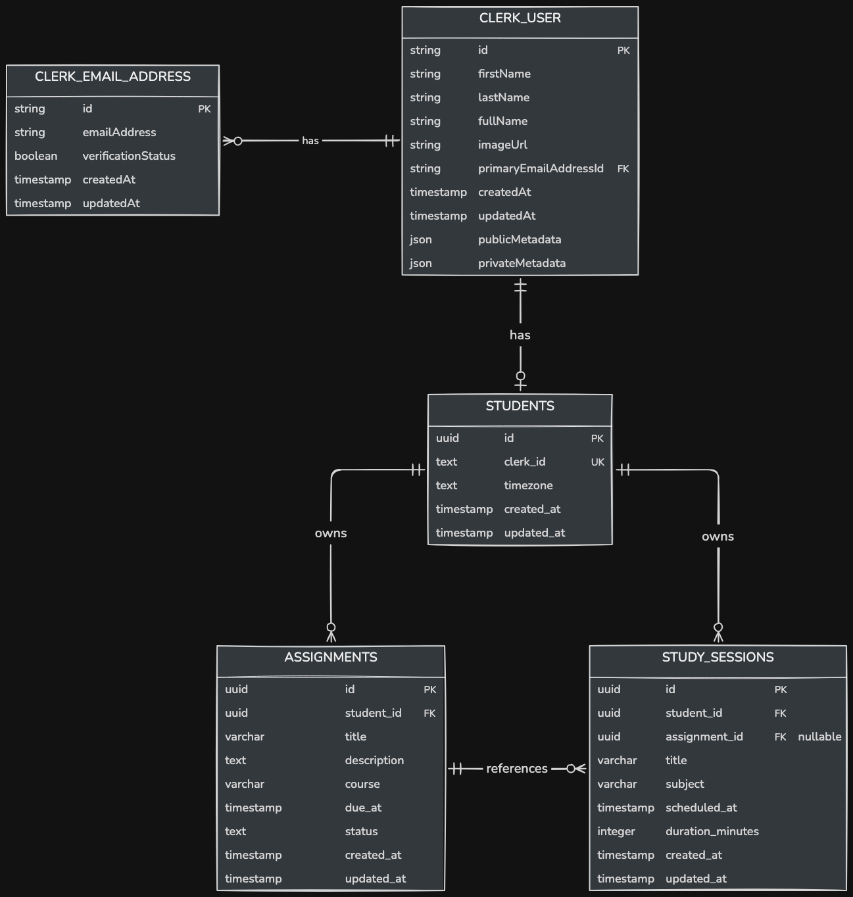

# Study-Mate Database Schema

This document outlines the database schema for the Study-Mate platform, detailing the structure and relationships of the primary entities: students, assignments, and study sessions.

## Students Entity

The student represents an individual using the Study-Mate platform.

Table name: students

| Column        | Type        | Constraints           | Purpose                     |
| ------------- | ----------- | --------------------- | --------------------------- |
| id            | UUID        | PK                    | Internal student identifier |
| clerk_user_id | TEXT        | UNIQUE, NOT NULL      | Clerk identity reference    |
| timezone      | TEXT        | NOT NULL, DEFAULT UTC | Student's timezone          |
| created_at    | TIMESTAMPTZ | NOT NULL              | Record creation             |
| updated_at    | TIMESTAMPTZ | NOT NULL              | Last update                 |

## Assignments Entity

The assignment represents a task or homework that a student needs to complete within the Study-Mate platform.

Table name: assignments

| Column      | Type         | Constraints               | Purpose                |
| ----------- | ------------ | ------------------------- | ---------------------- |
| id          | UUID         | PK                        | Assignment identifier  |
| student_id  | UUID         | FK, NOT NULL              | Assignment owner       |
| title       | VARCHAR(200) | NOT NULL                  | Assignment title       |
| description | TEXT         | NULL                      | Assignment description |
| course      | VARCHAR(120) | NULL                      | Course or subject      |
| due_at      | TIMESTAMPTZ  | NOT NULL                  | Deadline               |
| status      | TEXT         | NOT NULL, DEFAULT pending | Completion status      |
| created_at  | TIMESTAMPTZ  | NOT NULL                  | Record creation        |
| updated_at  | TIMESTAMPTZ  | NOT NULL                  | Last update            |

## Study Sessions Entity

The study session represents a planned activity where a student dedicates time to study, potentially associated with an assignment.

Table name: study_sessions

| Column           | Type         | Constraints  | Purpose            |
| ---------------- | ------------ | ------------ | ------------------ |
| id               | UUID         | PK           | Session identifier |
| student_id       | UUID         | FK, NOT NULL | Session owner      |
| assignment_id    | UUID         | FK, NULL     | Related assignment |
| title            | VARCHAR(200) | NOT NULL     | Session title      |
| subject          | VARCHAR(120) | NULL         | Course or subject  |
| scheduled_at     | TIMESTAMPTZ  | NOT NULL     | Scheduled start    |
| duration_minutes | INTEGER      | NOT NULL     | Planned duration   |
| created_at       | TIMESTAMPTZ  | NOT NULL     | Record creation    |
| updated_at       | TIMESTAMPTZ  | NOT NULL     | Last update        |

## Relationships

- A student can have multiple assignments.
- An assignment belongs to a single student.
- A student can have multiple study sessions.
- A study session belongs to a single student.
- A study session can optionally be linked to an assignment.
- A study session can be associated with a single assignment, but it is optional.
- An assignment can have multiple study sessions associated with it.
